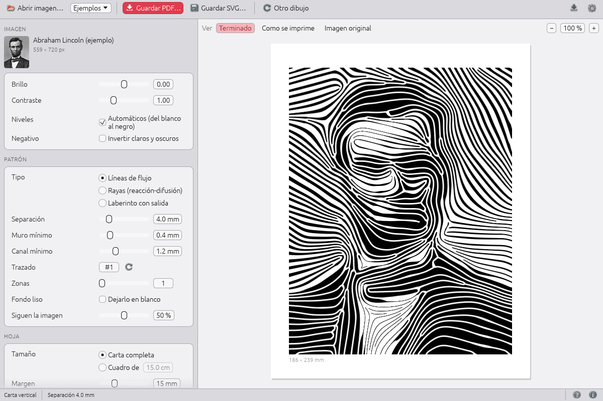
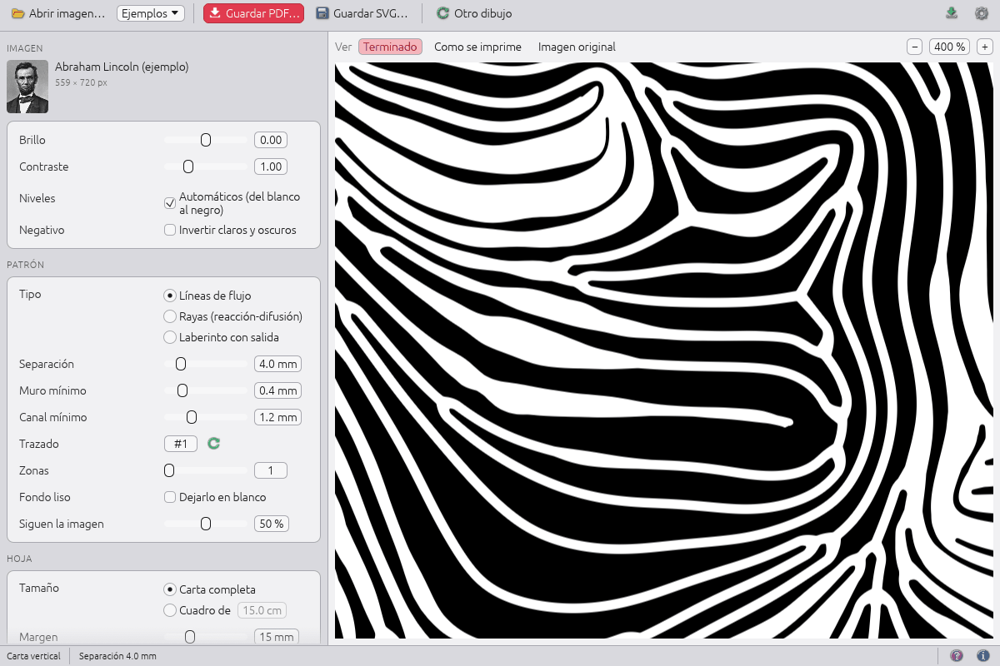
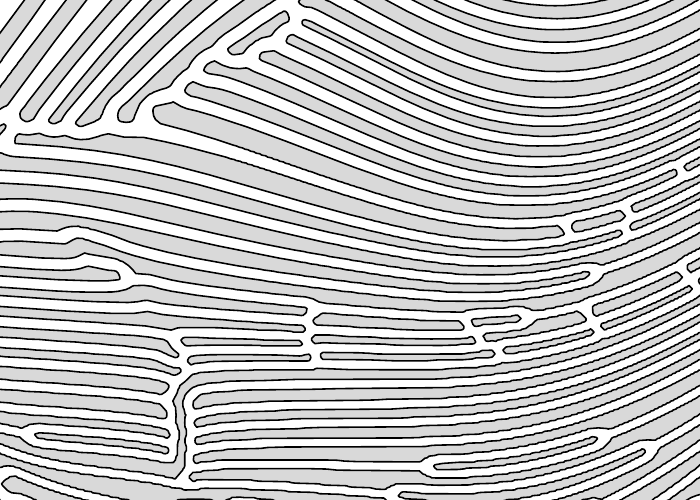
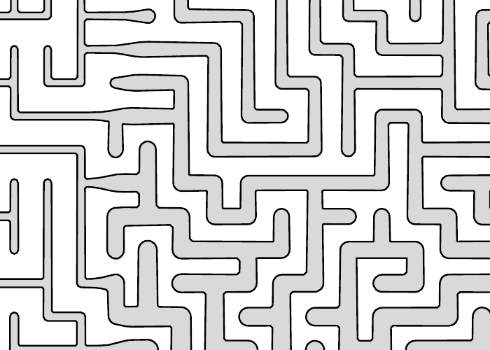
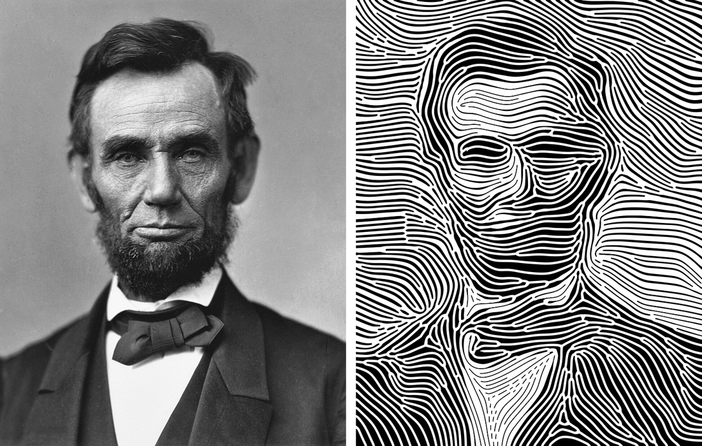
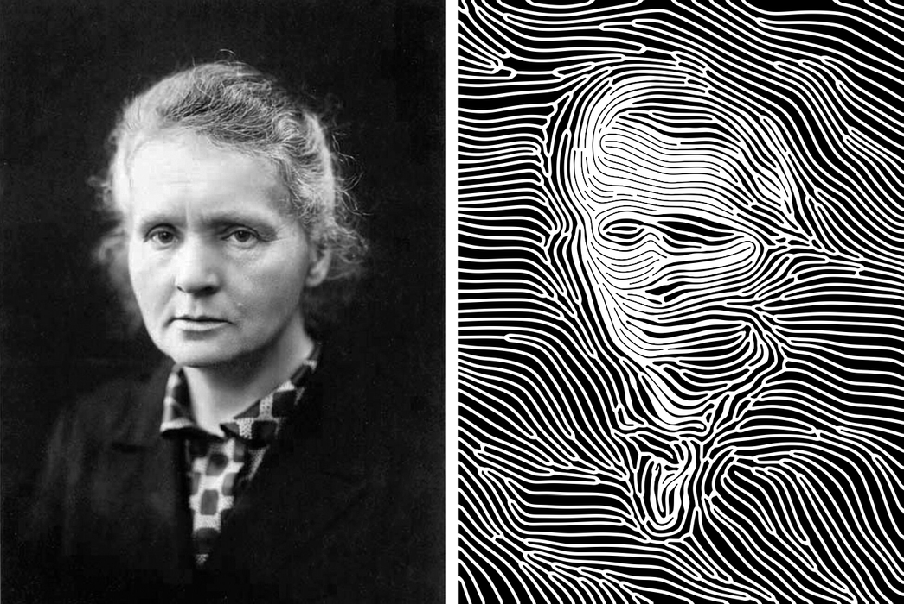

# dedalo

Convierte una imagen en un **laberinto para imprimir y rellenar a mano**. Los muros engordan en las
zonas oscuras de la imagen y adelgazan en las claras: de cerca es un laberinto, y de lejos, una
vez rellenado con pluma, aparece la imagen.



## Cómo funciona

1. **Abre una imagen** (PNG, JPEG, GIF, WebP o BMP), arrástrala a la ventana o elige uno de los
   **Ejemplos** incluidos (retratos de dominio público de Wikimedia Commons: Lincoln, Einstein,
   Douglass, Marie Curie y la Mona Lisa). Brillo, contraste, niveles automáticos y negativo ajustan
   cómo se lee.
2. **Elige el patrón:**
   - **Líneas de flujo:** líneas que avanzan con curvas suaves sin cruzarse nunca, como un grabado. En lo
     oscuro engordan hasta dejar solo el canal mínimo; en lo claro quedan finas (nunca huecos vacíos). Se
     colocan con el método de Jobard y Lefer (1997). Son largas, como espagueti: rodean las formas de la
     imagen como curvas de nivel (tensor de estructura a varias escalas, del detalle a la forma grande,
     con una ondulación suave; «Siguen la imagen», de 0 a 100 %). Con
     **Zonas**, cada banda de tono se rellena con sus propias líneas en otra dirección. Con **Fondo liso**,
     las zonas claras de un solo tono (por ejemplo, un fondo blanco) quedan sin líneas. Las líneas
     nunca se acercan más que un canal mínimo y dos muros mínimos, así siempre cabe la pluma.
   - **Rayas (reacción-difusión):** el modelo de Gray-Scott con el ajuste «laberinto»
     (F = 0.029, k = 0.057). Son rayas que se ramifican, como una huella dactilar.
   - **Laberinto con salida:** un laberinto perfecto, con un solo camino de la entrada (arriba a la
     izquierda) a la salida (abajo a la derecha). La vista puede mostrar la solución, que no se
     imprime.
3. **Separación:** la distancia de un canal al siguiente. **Muro mínimo** y **canal mínimo**
   garantizan que siempre quede un trazo visible y sitio para la pluma.
4. **Hoja:** carta completa (horizontal si la imagen es apaisada) o un cuadro de N cm centrado, con
   margen.
5. **Guardar PDF** (o SVG), en vectores y a tamaño real. Se puede imprimir:
   - contorno y muro en gris: una guía de qué rellenar;
   - solo el contorno;
   - los muros ya rellenos, como se verá al terminar.

La vista previa se acerca y se aleja con la rueda del ratón (hacia el puntero), se mueve arrastrando
y vuelve a la hoja entera con doble clic; al acercar se redibuja nítida la parte visible.



El tono decide, punto a punto, qué fracción de la superficie lleva tinta, igual que una trama de
imprenta. Por eso el patrón (lo lento de calcular) solo se rehace al cambiar su forma; brillo,
contraste y estilo de impresión se ven al momento.


Detalle de los PDF (líneas de flujo a 400 ppp y laberinto a 300 ppp):





Retratos de dominio público (Wikimedia Commons) en hoja carta con 2,5 mm de separación:





Rayas de reacción-difusión:


## Instalar

macOS y Linux (descarga la última versión publicada; vuelve a ejecutarlo para actualizar o
desinstalar):

```bash
curl -fsSL https://raw.githubusercontent.com/airylp/dedalo/main/install.sh | sh
```

Para compilarlo con lo último de `main`: `… | sh -s -- compilar` (instala Rust si falta).

Windows (PowerShell):

```powershell
[Net.ServicePointManager]::SecurityProtocol = 'Tls12'; irm https://raw.githubusercontent.com/airylp/dedalo/main/install.ps1 | iex
```

## Compilar

```sh
cargo build --release
cargo test --release
DEDALO_PNG=carpeta cargo test --release vista_previa -- --ignored --nocapture   # PNG y PDF de prueba
```

## Licencia

MIT.
